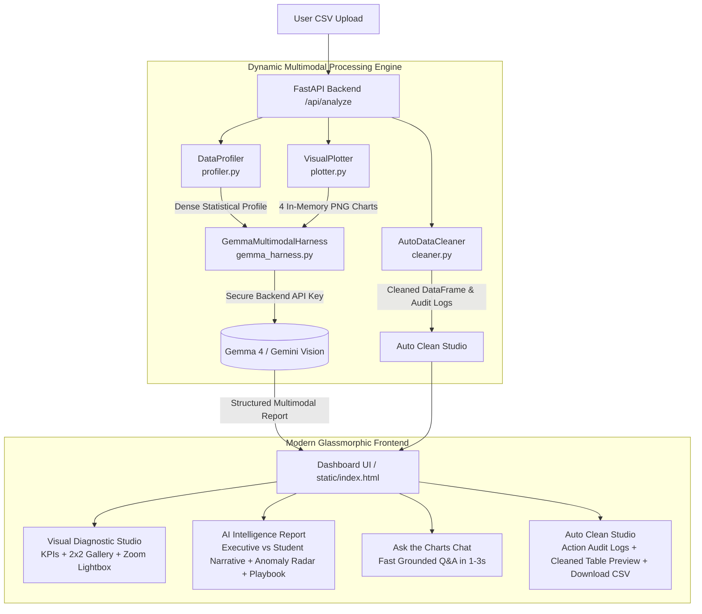

# Auto-analysis-hub 🦅
> **Autonomous Visual Data Diagnostic & Storytelling Agent**  
> *100% Dynamic Multimodal Vision Intelligence for Tabular Datasets*

[](https://opensource.org/licenses/MIT)
[](https://www.python.org/)
[](https://fastapi.tiangolo.com/)
[](https://ai.google.dev/)
[](https://www.docker.com/)

---

## 1. Project Concept & Value Proposition

Traditional text-only Large Language Models (LLMs) struggle with raw spreadsheet files. Passing thousands of raw CSV rows into a text prompt wastes tokens and blinds the AI to critical visual structures—such as **inflection dips, seasonal progression curves, non-linear correlations, and multi-dimensional outlier clusters**.

**Auto-analysis-hub** solves this through a pure dynamic multimodal vision pipeline:
1. **100% Dynamic Ingestion**: Every chart, health metric, and insight is generated in real-time from user-uploaded CSV files. Zero static mock buttons or pre-canned demo data.
2. **In-Memory 4-Panel Digital Plotting**: Programmatically renders high-contrast, dark-mode 110 DPI digital charts (Progression & Trend, Category Distribution, Correlation Heatmap, and Anomaly Radar) in **<150 milliseconds** with zero disk writes.
3. **High-Speed Multimodal Vision**: Transmits the digital chart images directly into **Gemma 4 & Gemini Vision** via the official Google GenAI Python SDK (`google-genai`), giving the model visual eyes to perceive graph contours alongside statistical tabular ground truth.
4. **Backend API Key Security**: The Gemini API key is configured securely on the backend server via `.env` or system environment variables—never exposed to or entered by frontend users.
5. **Dual Persona Intelligence**:
   - 👔 **Executive Leadership Mode**: Focuses on bottom-line financial exposure, revenue inflection points, capital allocation, and decisive operational risk playbooks.
   - 🎓 **Student & Researcher Mode**: Explains mathematical distribution geometry, Central Limit Theorem mechanics, Tukey 1.5× IQR fences, Pearson correlation sensitivities, and feature engineering workflows.
6. **Auto Clean Studio**: Audits and sanitizes datasets automatically (deduplication, skewness-adaptive numerical imputation, categorical mode filling, and 1.5× IQR outlier Winsorization) with full action audit logs, live cleaned table preview, and one-click CSV download.
7. **Ultra-Fast "Ask the Charts" Interactive Q&A**: Grounded visual questions answered in **1–3 seconds** with visual grounding.

---

## 2. System Architecture



---

## 3. Directory Layout

```
auto_analysis_hub/
├── auto_analysis_hub_skill/          # Modular Reusable Agent Skill & Model Harness
│   ├── __init__.py                   # Package exports and convenience APIs
│   ├── profiler.py                   # Dynamic pandas health & statistical summarizer
│   ├── plotter.py                    # Dynamic matplotlib/seaborn 4-panel chart engine
│   ├── cleaner.py                    # Automated data hygiene agent & audit logger
│   └── gemma_harness.py              # Multimodal vision harness with dual personas
├── static/
│   └── index.html                    # Clean dark-mode glassmorphic SPA dashboard
├── main.py                           # Unified FastAPI backend server & REST API
├── requirements.txt                  # Pinned Python dependencies
├── Dockerfile                        # Production container specification
├── .dockerignore                     # Docker build exclusions
├── .gitignore                        # Git repository exclusions
├── .env.example                      # Environment variables template
├── .env                              # Backend configuration file
├── LICENSE                           # MIT Open-Source License
└── README.md                         # Architecture diagram & quickstart guide
```

---

## 4. Local Setup & Quickstart

### Prerequisites
* Python 3.10 or 3.11+
* Google Gemini API Key ([Google AI Studio](https://aistudio.google.com/))

### Installation Steps

1. **Clone the repository:**
   ```bash
   git clone https://github.com/your-username/auto-analysis-hub.git
   cd auto-analysis-hub
   ```

2. **Create and activate a virtual environment:**
   ```bash
   # Windows (PowerShell)
   python -m venv venv
   .\venv\Scripts\Activate.ps1

   # Linux / macOS
   python3 -m venv venv
   source venv/bin/activate
   ```

3. **Install dependencies:**
   ```bash
   pip install -r requirements.txt
   ```

4. **Configure backend environment variables:**
   ```bash
   cp .env.example .env
   ```
   Edit `.env` and set your `GEMINI_API_KEY`:
   ```ini
   GEMINI_API_KEY=your_gemini_api_key_here
   DEFAULT_MODEL=gemini-2.5-flash
   HOST=0.0.0.0
   PORT=8000
   ```

5. **Start the application:**
   ```bash
   python main.py
   ```
   or with Uvicorn:
   ```bash
   uvicorn main:app --host 0.0.0.0 --port 8000 --reload
   ```

6. **Open the Dashboard:**  
   Navigate your browser to [http://localhost:8000](http://localhost:8000).

---

## 5. Docker Deployment

Deploying with Docker is zero-configuration:

```bash
# 1. Build the Docker image
docker build -t auto-analysis-hub .

# 2. Run container with backend environment key
docker run -p 8000:8000 -e GEMINI_API_KEY="your_api_key_here" auto-analysis-hub
```

Or pass your `.env` file directly:
```bash
docker run -p 8000:8000 --env-file .env auto-analysis-hub
```

Access the application at `http://localhost:8000`.

---

## 6. Cloud Platform Deployment (GitHub Actions, Railway, Render, DigitalOcean)

### DigitalOcean App Platform / Render / Railway:
1. Push your repository to GitHub.
2. Create a new Web Service pointing to your GitHub repo.
3. Build Command: `pip install -r requirements.txt`
4. Start Command: `uvicorn main:app --host 0.0.0.0 --port 8000`
5. Set Environment Variable in the dashboard:
   - `GEMINI_API_KEY` = `your_gemini_api_key`
   - `DEFAULT_MODEL` = `gemini-2.5-flash`

---

## 7. REST API Reference

| Endpoint | Method | Description |
| :--- | :---: | :--- |
| `/` | `GET` | Serves the unified dark-mode dashboard UI. |
| `/api/health` | `GET` | Returns system health, cache status, and backend API key status. |
| `/api/analyze` | `POST` | Accepts user CSV file, executes profiler, plotter, cleaner, and multimodal vision in <1s. |
| `/api/chat` | `POST` | Ultra-fast multimodal "Ask the Charts" grounded Q&A (1-3s). |
| `/api/clean` | `POST` | Executes data hygiene pipeline on active session dataset. |
| `/api/clean/download/{id}` | `GET` | Downloads sanitized and cleaned CSV by analysis session ID. |

---

## 8. License

This project is licensed under the [MIT License](LICENSE).
